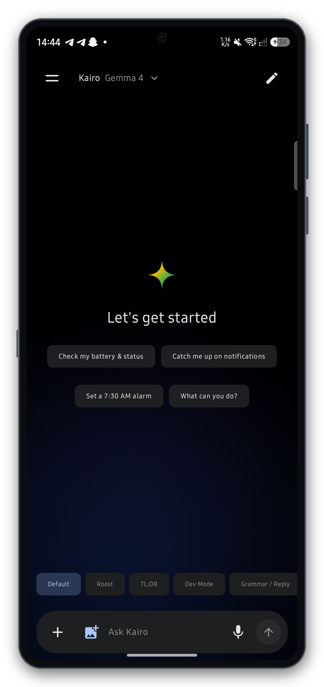

# Kairo (On-Device AI Agent)

An on-device Android AI agent created by **DaManMikey** ([damanmikey.me](https://damanmikey.me/)), powered by **Gemma 4** via **Android AICore** (`com.google.mlkit:genai-prompt`).

- **Website:** https://damanmikey.me/
- **Source Code:** https://github.com/DaDevMikey/Kairo
- **Privacy Policy:** [PRIVACY_POLICY.md](PRIVACY_POLICY.md)
- **Terms of Service:** [TERMS_OF_SERVICE.md](TERMS_OF_SERVICE.md)

## Screenshots

| Home & Quick Prompts | AI Engine & Model Selector | Floating Overlay & Widget | Drawer & Recent Chats |
| :---: | :---: | :---: | :---: |
|  |  |  |  |

## Features
- **100% Local On-Device Gemma 4**: Streaming text and multimodal image understanding (`ImagePart`) with zero external AI servers.
- **System Digital Assistant**: Integrates with `VoiceInteractionService` + `ACTION_ASSIST` and a dedicated **Kairo Overlay** launcher with swipe-to-fullscreen.
- **Screen Context**: Reads `AssistStructure` and captures the current screen in the overlay (`Ask about screen`).
- **Multi-Step Tool Calling & App Connections**:
  - **Health Connect**: Read today's steps and heart rate (`get_health_summary`).
  - **Contacts & Comms**: Look up contacts (`find_contact`), dial (`dial_phone`), SMS (`send_sms`), Email (`send_email`), Calendar events (`create_calendar_event`).
  - **Device & Media**: Open apps (`open_app`), find installed apps (`find_installed_apps`), device status (`get_device_status`), alarms/timers, settings, flashlight, volume, Google Maps navigation (`navigate_to`), YouTube search (`search_youtube`), web search (`web_search`), media playback (`play_media`), camera, URLs, share, clipboard.
- **Persistent Memory & Recent Chats**: Remembers facts across sessions, with per-chat delete and copy/share/speak/regenerate actions.
- **Voice I/O & Wake Word**: Offline `SpeechRecognizer` + `TextToSpeech` and optional `"Hey Kairo"` wake-word service.

## License
[MIT](LICENSE)
