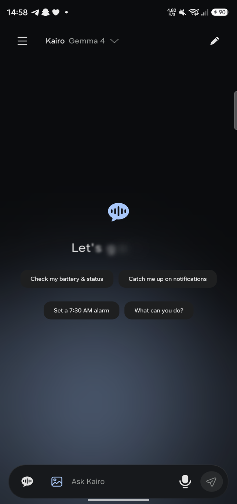
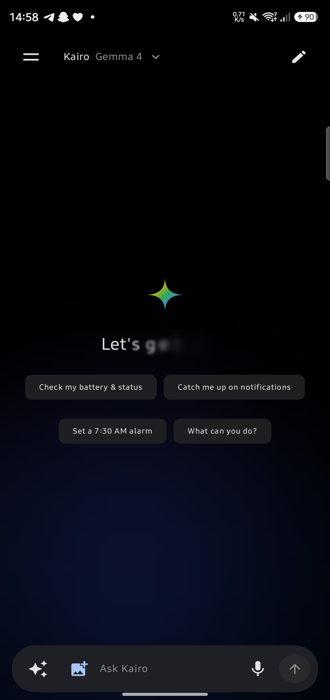
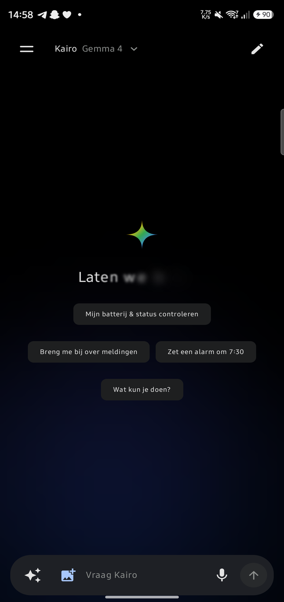
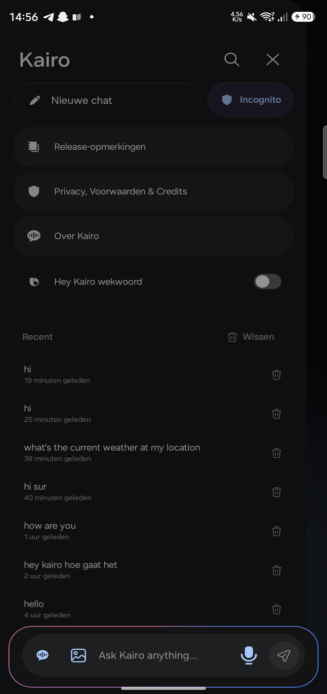
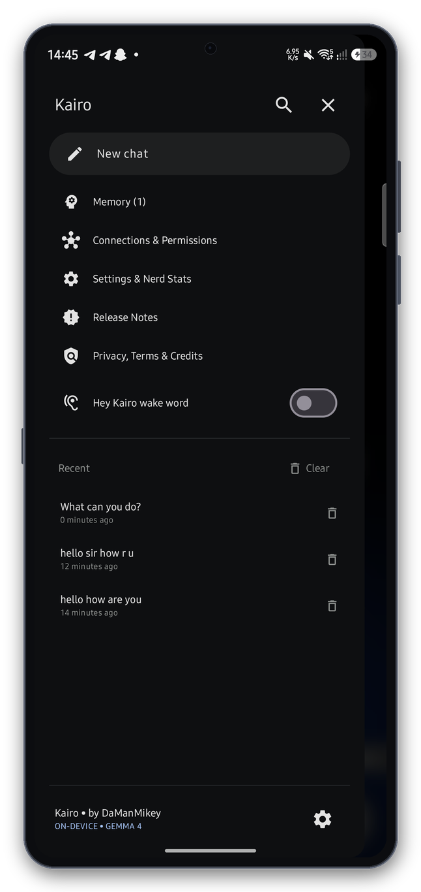
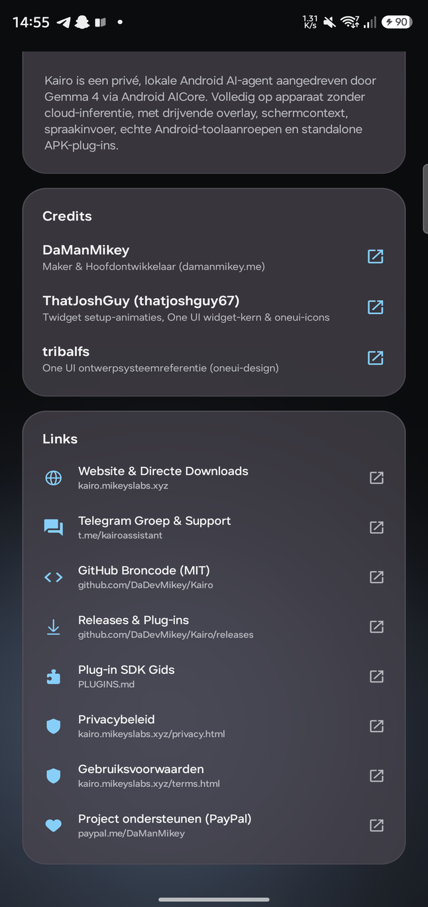

<p align="center">
  
</p>

<h1 align="center">Kairo — On-Device AI Agent for Android</h1>

<p align="center">
  <b>Fast, Private & Offline Intelligence Powered by Google Gemma 4 via Android AICore</b>
</p>

<p align="center">
  <a href="https://github.com/DaDevMikey/Kairo/releases/latest"></a>
  <a href="https://t.me/kairoassistant"></a>
  <a href="https://damanmikey.me/"></a>
  <a href="LICENSE"></a>
</p>

---

**Kairo** is an entirely on-device, privacy-first AI agent built natively for Android. Powered by **Gemma 4** through the hardware-accelerated **Android AICore** engine (`com.google.mlkit:genai-prompt`), Kairo streams reasoning and multimodal answers directly on your device without relaying private context or conversations to external servers.

- 🌐 **Official Website:** [kairo.mikeyslabs.xyz](https://kairo.mikeyslabs.xyz/) / [damanmikey.me](https://damanmikey.me/)
- 📥 **Direct APK Download:** [kairo.mikeyslabs.xyz/download](https://kairo.mikeyslabs.xyz/download/)
- 💬 **Official Telegram Group:** [t.me/kairoassistant](https://t.me/kairoassistant)
- 📦 **GitHub Releases & Plugins:** [Releases](https://github.com/DaDevMikey/Kairo/releases)
- 🔒 **Privacy Policy:** [PRIVACY_POLICY.md](PRIVACY_POLICY.md)
- 📜 **Terms of Service:** [TERMS_OF_SERVICE.md](TERMS_OF_SERVICE.md)

---

## 📱 Screenshots

### Themes & Languages
| English (One UI Theme) | English (Base Theme) | Dutch / Nederlands (Base Theme) |
| :---: | :---: | :---: |
|  |  |  |

### System Features
| Assistant Overlay | Navigation Drawer | Credits & Settings Info |
| :---: | :---: | :---: |
|  |  |  |

---

## ✨ Key Features

- **100% Local On-Device Gemma 4**: Real-time streaming token generation and multimodal vision understanding (`ImagePart`) running on your device NPU/GPU via AICore. Zero cloud relays.
- **System Digital Assistant**: Native `VoiceInteractionService` + `ACTION_ASSIST` integration and a gesture-driven **Kairo Overlay** popup with pull-to-fullscreen handoff.
- **Screen Context Analysis**: Inspects `AssistStructure` and captures current window frames on command (`"Ask about screen"`).
- **Extensible Plugin Ecosystem**:
  - Modular APK plugins with dynamic APK signature verification.
  - **One UI SESL9 Design Plugin**: Full Samsung One UI 8.5/SESL9 styling, high-contrast controls, blur reveals, and frosted glass home/cover widgets.
  - See [PLUGINS.md](PLUGINS.md) for plugin authoring specs.
- **Actionable Tool Calling & Deep Android Integrations**:
  - **Health Connect**: Fetch steps, heart rate, active calories (`get_health_summary`).
  - **Contacts & Communications**: Contact search (`find_contact`), direct dial (`dial_phone`), SMS dispatch (`send_sms`), email drafts (`send_email`), calendar scheduling (`create_calendar_event`).
  - **Device Automation**: App discovery & launching (`open_app`, `find_installed_apps`), battery & storage inspection (`get_device_status`), alarms, timers, flashlight, volume, Google Maps navigation (`navigate_to`), YouTube searches (`search_youtube`), media playback (`play_media`), and clipboard synchronization.
- **Fluid UI & Animations**:
  - Smooth letter-by-letter blur reveal streaming for model outputs.
  - Android 14/15 Predictive Back gesture animations in Settings.
  - Material 3 & SESL9 styling toggles.
- **Internationalization (i18n)**: Comprehensive localization support including English, Dutch (Nederlands), German (Deutsch), Russian (Русский), and Chinese (中文).
- **Persistent Memory & Privacy Controls**:
  - Secure local facts database across sessions.
  - Quick-action drawer with one-tap history clear, incognito mode, and prompt/response clipboard copying.
- **Voice I/O & Wake Word**:
  - Offline `SpeechRecognizer` and `TextToSpeech` integration.
  - Low-power `"Hey Kairo"` foreground wake-word detector.

---

## 🎨 App Icon Assets

Looking for the high-resolution logo or Telegram group icon?
- **Square 1024x1024 Logo:** [`kairo_logo_1024.png`](docs/kairo_logo_1024.png)
- **Circular 1024x1024 Avatar (Telegram Icon):** [`kairo_avatar_circle.png`](docs/kairo_avatar_circle.png)
- **Standard 512x512 Logo:** [`kairo_icon.png`](kairo_icon.png) / [`docs/kairo_logo_512.png`](docs/kairo_logo_512.png)
- **Circular 512x512 Avatar:** [`kairo_avatar_512.png`](docs/kairo_avatar_512.png)

---

## 🛠️ Building & Developing

### Requirements
- Android Studio Ladybug / Meerkat or newer
- Android SDK 35 (compileSdk 35, minSdk 28)
- Java 17+
- A device with **Android AICore** support (e.g., Pixel 8+, Samsung Galaxy S24+, Z Flip 6/7, Z Fold 6/7)

### Build Commands
```bash
# Debug build
./gradlew assembleDebug

# Release build
./gradlew assembleRelease

# One UI Theme Plugin build
./gradlew :oneui-theme-plugin:assembleRelease
```

---

## 👥 Community & Credits

- **Creator & Lead Developer:** [DaManMikey](https://damanmikey.me/)
- **Theme & Widget Contributions:** [ThatJoshGuy](https://github.com/thatjoshguy67)
- **Design System Inspiration:** [tribalfs](https://github.com/tribalfs)
- **Community Group:** Join the official discussion on Telegram at [t.me/kairoassistant](https://t.me/kairoassistant).

---

## 📄 License

This project is licensed under the [MIT License](LICENSE).
